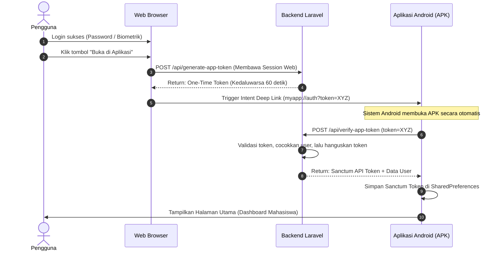

# Panduan Arsitektur: Login Web Langsung Masuk ke Aplikasi Android (APK) Tanpa Login Ulang

Dokumen ini berisi panduan teknis, alur data, dan langkah implementasi jika Anda ingin menghubungkan akun yang sudah login di Website Laravel ke Aplikasi Mobile (APK Android) tanpa meminta pengguna memasukkan password lagi.

---

## 1. Konsep Utama: Single Sign-On (SSO) via Deep Linking

Pendekatan standar industri menggunakan metode **One-Time Authentication Token + Deep Link**:
1. Pengguna login di Web (bisa via Password maupun Biometrik Wajah Face-API).
2. Di halaman Web tersedia tombol **"Buka di Aplikasi"**.
3. Laravel menghasilkan **One-Time Token** acak yang hanya berlaku selama 60 detik.
4. Browser memicu tautan **Deep Link** Android (`myapp://auth?token=...`).
5. HP membuka APK Android secara otomatis.
6. APK menukarkan token tersebut ke API Laravel dan menerima **API Token (Laravel Sanctum)** permanen.
7. Pengguna langsung masuk ke beranda APK.

---

## 2. Diagram Alur Sistem (Sequence Diagram)



---

## 3. Komponen yang Perlu Disiapkan di Sisi Laravel (Backend)

### A. Tabel Database Penyimpan Token Sementara
Migration tabel `app_login_tokens`:
```php
Schema::create('app_login_tokens', function (Blueprint $table) {
    $table->id();
    $table->foreignId('user_id')->constrained('users')->onDelete('cascade');
    $table->string('token', 64)->unique();
    $table->timestamp('expires_at');
    $table->boolean('is_used')->default(false);
    $table->timestamps();
});
```

### B. Endpoint Pembuat Token (Web Controller)
```php
public function generateAppToken(Request $request)
{
    $token = Str::random(40);

    AppLoginToken::create([
        'user_id' => Auth::id(),
        'token' => hash('sha256', $token),
        'expires_at' => now()->addSeconds(60),
        'is_used' => false,
    ]);

    // Format Deep Link Android
    $deepLink = "myapp://auth-callback?token=" . $token;

    return response()->json([
        'status' => 'success',
        'deep_link' => $deepLink
    ]);
}
```

### C. Endpoint Verifikasi di API Laravel (`routes/api.php`)
```php
Route::post('/verify-app-token', function (Request $request) {
    $hashed = hash('sha256', $request->token);

    $record = AppLoginToken::where('token', $hashed)
        ->where('is_used', false)
        ->where('expires_at', '>', now())
        ->first();

    if (!$record) {
        return response()->json(['message' => 'Token tidak valid atau kedaluwarsa'], 401);
    }

    // Hanguskan token agar tidak bisa dipakai 2 kali
    $record->update(['is_used' => true]);

    // Buat token API permanen untuk APK (Laravel Sanctum)
    $apiToken = $record->user->createToken('android-app')->plainTextToken;

    return response()->json([
        'status' => 'success',
        'token' => $apiToken,
        'user' => $record->user
    ]);
});
```

---

## 4. Komponen yang Perlu Disiapkan di Sisi Android (APK)

### A. Konfigurasi `AndroidManifest.xml` (Menangkap Deep Link)
Tambahkan `intent-filter` pada Activity penerima login:
```xml
<activity android:name=".AuthCallbackActivity" android:exported="true">
    <intent-filter>
        <action android:name="android.intent.action.VIEW" />
        <category android:name="android.intent.category.DEFAULT" />
        <category android:name="android.intent.category.BROWSABLE" />
        <data android:scheme="myapp" android:host="auth-callback" />
    </intent-filter>
</activity>
```

### B. Menerima Token di Android (Kotlin / Java / Flutter)
Saat APK terbuka via deep link, ambil data token dari URL:
```kotlin
val uri: Uri? = intent?.data
val token = uri?.getQueryParameter("token")

if (token != null) {
    // 1. Panggil API Laravel /api/verify-app-token
    // 2. Simpan API Token hasil response ke SharedPreferences
    // 3. Pindah ke MainActivity / Dashboard
}
```

---

## 5. Keamanan Sistem (Security Best Practices)
1. **Single-Use (Sekali Pakai)**: Begitu token ditukarkan APK, langsung tandai `is_used = true` di database sehingga tidak bisa disadap atau dipakai ulang.
2. **Short Lifetime**: Masa aktif token dibuat sangat singkat (60 - 120 detik).
3. **Android App Links (Opsional - Lebih Aman)**: Gunakan domain resmi HTTPS dengan verifikasi `assetlinks.json` agar hanya APK resmi milik Anda yang dapat membuka URL tersebut.
